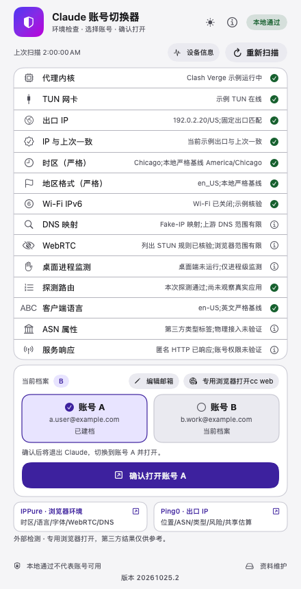
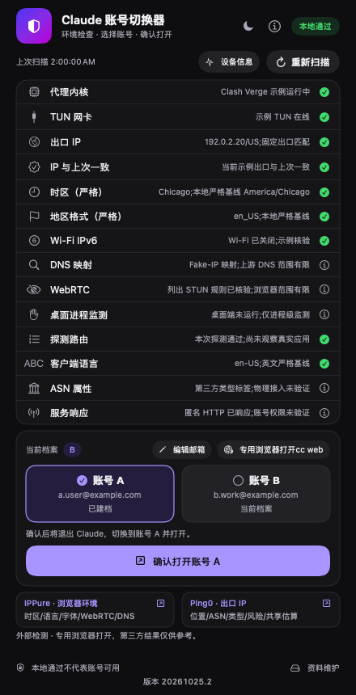

<div align="center">

# Claude 切换器

**本地环境检查与桌面账号切换 —— 在启动前发现配置与连接问题**

> 当前macOS定制界面版本：**20261025.2**。请查看[`custom/strict-macos`分支](https://github.com/carljings/claude-switcher/tree/custom/strict-macos)；仓库默认`main`仍保留旧版内容。

[](LICENSE)
[]()
[](windows/)
[](linux/)
[]()


</div>

---

## 本定制分支

面向macOS的本地严格配置：固定出口与所选节点叠加核验、时区/地区/英文基线、实际TLS探测路由、有限范围桌面守护、重新扫描、全文详情、黑白直切、专用Edge入口。专用入口以Chicago/en-US为本地基线，保留真实设备信息，不提供“防封号”承诺。匿名HTTP响应不验证当前账号；历史账号状态备注的展示与读取已移除。

用户提供的指南、截图和五个平台的调研已汇总为[注意事项与落实总清单](docs/CLAUDE-SAFETY-CHECKLIST.md)，分别列出已落实、未实施及原因、用户自行注意的事项。新号等约一周再订阅等经验单独标注，不当作官方门槛。安装维护以本分支[AGENTS.md](AGENTS.md)和[使用边界](docs/USAGE-SAFETY.md)的最新规则为准；实际App位于用户Applications，桌面保留入口链接。

专用浏览器现可加载[最小字体过滤组件](docs/PLUGIN-FONT-GUARD.md)，仅作用于指定Claude/IPPure站点，保留系统字体、真实UA和固定代理；主界面最底部显示实际构建版本。

[外部检测](docs/EXTERNAL-CHECKS.md)在主窗口平铺IPPure与Ping0用途总结及专用浏览器跳转，每次沿用严格预检，网页结果由用户查看。Claude网页入口为“专用浏览器打开cc web”，不随A/B选择切换网页账号。重装或升级验证成功后清理本次替换的旧App，固定实际路径为`~/Applications/Claude切换器.app`，桌面为该路径的链接；加入程序坞时也应选择该实际App。

[资料扫描与维护](docs/LOCAL-MAINTENANCE.md)提供专用Edge缓存清理、资料重建，以及当前桌面/预置独立CLI本地ID重置。先预览固定清单和影响，确认后保存私有备份；恢复也先预览。没有目标不表示所有指纹已清除，真实资料不会因扫描、安装或更新自动清理。

专用链路需要另行配置私有固定出口策略、具体节点和loopback listener；源码及安装包不携带用户的节点、服务器、账号或凭据。[本机网络架构与脱敏示例](docs/NETWORK-ARCHITECTURE.md)用于说明已有部署，不表示安装后自带三节点或VPS。

远程覆盖式自动更新已禁用；在自己的分支审阅、合入和测试上游修复。私有配置、代理凭据和账号数据不得提交。新增命令和验证边界见[使用说明](docs/USAGE-SAFETY.md)。

本轮上游检查、已有适配和未同步范围见[2026-10-25上游审阅记录](docs/UPSTREAM-REVIEW-2026-10-25.md)，不通过切回`main`或覆盖整包更新此定制。

获取此定制分支：

```bash
git clone --branch custom/strict-macos https://github.com/carljings/claude-switcher.git
```

以下说明针对本分支的macOS定制；Windows/Linux保留各自Beta实现，未做同等实机验证。

## 为什么做这个

代理未运行、规则漏配和出口漂移都可能造成连接问题。本项目在启动前检查当前配置与探测信号，并管理Claude桌面端的本地会话快照。

检查通过不等于账号获得访问许可或不会被停用。账号使用应遵守官方服务条款、使用政策及适用地区要求，详见[使用建议与检查边界](docs/USAGE-SAFETY.md)。

> 本地改进版在桌面端运行时核验所选出口及API探测链路，连续两次异常后终止桌面主进程。它不保护浏览器或独立CLI，存在巡检窗口，属于进程级保护，不是防火墙级保证。

## 主要功能

### 1. Block-on-Fail 环境审计引擎

macOS版显示14项检查。故障项阻止启动；提醒项表示存在限制或需要核实，不等同于故障：

| # | 检查项 | 防什么 |
|---|---|---|
| 01 | 代理内核 | 代理根本没在跑就启动 |
| 02 | TUN 网卡 | 系统代理开着但流量没被接管 |
| 03 | 出口 IP | 核对目标国家；配置了固定IPv4时同时校验该值 |
| 04 | IP 一致性 | 与上次探测比对，显示48小时内不同IP个数 |
| 05 | 时区（严格） | 按本地基线核对，不符阻止启动；非官方封禁判据 |
| 06 | 地区格式（严格） | 按本地基线核对，不符阻止启动 |
| 07 | Wi-Fi IPv6 | 核对Wi-Fi接口配置；Clash内核IPv6另在路由核验中检查，不覆盖所有接口 |
| 08 | DNS 映射 | 只报告指定域名映射；不覆盖全部DNS路径 |
| 09 | WebRTC | 多节点 STUN 交叉探测（详见第 2 节） |
| 10 | 桌面进程监测 | 近期出口与API链路监测证据；非防火墙保证 |
| 11 | 探测路由 | 按探测连接源端口核对控制器规则、代理链与所选出口 |
| 12 | 客户端语言 | 本地严格策略要求英文，不符阻止启动 |
| 13 | ASN 属性 | 归属名称匹配或待核验；不判定具体IP的住宅/托管用途 |
| 14 | 服务响应 | 核心协议键为“生态可达性”；区分传输故障、访问限制、限流和服务端异常，不验证账号 |

> 「IP 与上次一致」保留48小时出口历史，出现至少3个不同IP时显示提醒。这是本地稳定性提示，不是切换次数或已知的官方封禁阈值。可选私有文件`~/.claude-switcher/expected-exit-ip`指定固定IPv4；不匹配或文件无效时检查失败，详见[配置说明](docs/USAGE-SAFETY.md#可选固定出口校验)。

主界面常驻“重新扫描”（Command-R）与最近扫描时间；每次读取当前网络，空结果或缺项不复用旧扫描，不切换账号。单击右上角月亮/太阳按钮即可直接切换黑色或白色皮肤，自动记住选择，说明页同步切换；皮肤切换不触发扫描或账号操作。点击任意检查项可查看完整结果与对应处理建议，并选中文字复制。

账号操作分为“选择A/B”和“确认打开账号X”（Command-Return）。选择不切换档案，当前档案另行显示；确认时重新检查严格环境，通过后才切换并请求打开Claude。处理中防止重复提交；失败保留选择，重新扫描后可重试。

红色故障阻止启动，黄色表示需要核实，灰色表示确认记录或范围说明。旧调试历史已确认且当前出口与上次一致时正常通过；探测路由通过仅代表本次受控探测及已观察连接，未观察的应用连接仍未核验。

### 2. 纯标准库手写 STUN 协议栈的 WebRTC 泄漏探针

不依赖浏览器内核，直接用 `socket` + `struct` 构造 RFC 5389 Binding Request，解析 XOR-MAPPED-ADDRESS。它检查Python探针的UDP路径，不能代替实际浏览器的ICE检测。

探测列表包含Google、Cloudflare和国内服务。收到的公网地址与出口探测值不同会报告失败；当前严格策略下，全部无响应且缺少拒绝规则证据也会阻止启动。只有实时核验到四个探测域名及指定端口的优先UDP拒绝规则时，才显示灰色策略说明；这不能证明全部UDP或浏览器WebRTC路径均已覆盖。用户已确认的历史与第三方标签可按具体IPv4记录，详见[范围说明](docs/USAGE-SAFETY.md#已确认记录与灰色说明)。

### 3. 有限范围的桌面运行监测

launchd约每10秒调度一次root目录中的守护脚本。Clash专用策略核验固定出口及API探测路由，连续两次故障或缺证后终止Claude桌面主进程；其他客户端的基础检查范围不同。守护不终止专用浏览器或独立CLI，也不能保证发现问题前没有流量发出。专用Edge依靠固定代理入口，CLI另有专用TCP约束，详见[各入口的保护边界](docs/USAGE-SAFETY.md)。

### 4. Session Snapshot 快照隔离

切换前退出Claude桌面端，再封存和载入对应的数据目录。此操作不等同于完整设备、系统钥匙串或原生CLI账号隔离，也不保证服务端把账号视为固定设备。CLI多账号应采用官方支持的独立`CLAUDE_CONFIG_DIR`和认证流程。

macOS归档优先移动目录，载入尝试APFS写时复制（COW）；不支持时回退`ditto`全量复制，可用`CLAUDE_SWITCHER_NO_CLONE=1`强制回退。归档、复制或提交失败会停止；`.new`、`.previous`等恢复现场存在时拒绝继续切换，不能为重试直接删除它们。

### 5. 配置漂移自愈（Watchdog）

root时区看门狗按已配置目标恢复时区。时区、地区格式与英文语言按用户选择的严格基线核对，不符阻止启动；这些要求不代表官方封禁规则。网络修复不修改或放宽地区与语言设置，调整需走显式配置流程。

### 6. Pinned Routing 置顶路由

导入规则只是配置意图。新版探测路由项通过无认证TLS连接并按源端口核对控制器记录，不再用Fake-IP或文本存在代替实际匹配；应用真实连接未出现时明确标注尚未观察。详细证据可运行 `claude-switch.sh network-report`。

## 验证范围

本分支使用隔离HOME和伪命令测试环境判定、快照故障、组件安装、专用入口与UI交互；实际Edge、固定路由和权限设置的本机验证另行记录。测试通过、请求打开成功、用户手工网页检测和真实账号权限是不同证据，不能相互替代。具体已验与未验项目见[落实总清单](docs/CLAUDE-SAFETY-CHECKLIST.md)。

## 界面

| 白色 | 黑色 |
|---|---|
|  |  |

两图**基于20261025.2生产视图和隔离示例数据，非实时网络或账号证明**：IP使用保留测试地址，邮箱使用`example.com`，没有读取真实账号资料。所用生产视图源码SHA256为`28707582d6e8b2479e1394ae32e33434d491d2e92ad4660db088d2c2da422e81`。首屏展示14项检查、A/B两步确认、cc web入口、外部检测和资料维护；底部显示实际构建号，账号状态备注已移除。旧版本截图保留作历史资料。

界面为原生SwiftUI单文件应用，无Xcode工程；安装时需要`swiftc`和系统框架。仓库包含图标PNG、图标生成源码及界面预览素材。

## 安装

**macOS安装器要求**：macOS 13或更新版本、python3、提供`swiftc`的Xcode命令行工具、Claude桌面版及可用TUN代理。专用网页入口另需Microsoft Edge。基础检查支持Clash Verge / Shadowrocket / sing-box / ClashX / Surge；本分支完整的专用固定链路依赖Clash Verge/Mihomo控制器及私有策略，不能据此声称其他客户端具有相同核验能力。

> **Windows 用户**：[`windows/`](windows/) 目录提供 Windows 版（PowerShell + WPF，Beta），安装与注意事项见 [windows/README.md](windows/README.md)。
> **Linux 用户**：[`linux/`](linux/) 目录提供 Linux 版（bash + systemd，Beta），设计取舍（无官方桌面版→切换浏览器登录态）见 [linux/README.md](linux/README.md)。

按上方命令克隆`custom/strict-macos`后，先阅读[安装交接规则](AGENTS.md)和[使用边界](docs/USAGE-SAFETY.md)，再运行`installer/安装.command`。安装器会编译签名App、安装配套模块并请求系统配置所需管理员授权；只复制App不等于完成专用策略、root守护与网络配置。出口、固定IP、listener、实际路由及root文件权限应分别验收；没有未解决的启动故障即可，灰色说明和待核验项不要求全部变绿。

## 固定出口与地区变更

安装器按当时出口生成国家、参考时区和地区格式目标。当前专用入口还固定要求US、Chicago/en-US，并叠加核验私有`expected-exit-ip`、所选具体节点及listener；节点在策略列表中不代表可以任意更换出口。

`set-region`仍是显式修改脚本地区目标、系统地区格式和时区看门狗的命令，**不会同步重建这些固定出口约束，也不会把专用入口改为支持其他国家**。维护此严格部署时，更换出口应先审阅对应私有策略与基线、同步必要系统模块，再核验实际生成配置和路由。未核验通过前停止使用受保护入口，不能靠一次`set-region`或取消IP锁来绕过失败项。

## 不会配置？交给你的 AI

仓库根目录的[`AGENTS.md`](AGENTS.md)可作为本地Agent的安装与维护交接资料，包含当前定制优先规则、排障记录、授权与验收边界。应先让Agent读取实际源码和本机状态；文档本身不代表已经安装或验证成功。

## 使用

1. 双击桌面入口，等待14项检查；需要复核时点“重新扫描”。红项阻止桌面账号启动，黄项需核实，灰项说明范围，不要求全绿。
2. 使用网页时点击“专用浏览器打开cc web”。该入口独立执行专用链路预检，A/B选择不切换它的网页登录态。
3. 需要第三方检测时，在首屏点击IPPure或Ping0并自行查看网页结果；切换器不读取评分，也不验证Claude账号权限。
4. 使用桌面账号快照时，先选A/B，再点“确认打开账号X”。确认会重新检查并退出、切换、打开Claude；首次档案可能需要按官方流程登录。邮箱仅为本地标签，不验证实际登录身份。
5. 有故障先点该项查看全文，再处理对应配置或执行“一键修复”；修复只覆盖已实现项目。出现快照恢复标记时保留现场，按[使用说明](docs/USAGE-SAFETY.md)核对。

## Web 版环境检测（零安装）

仓库`docs/`另含静态浏览器自检页，可单独部署；它与App中的IPPure/Ping0外部检测入口是不同功能。本分支的GitHub Pages发布状态需另行核实，上游演示站不代表此定制分支。

页面逐项评估 6 类浏览器侧信号，并给出总评与失败项：

- **出口 IP / 归属**：ipinfo.io 优先，Cloudflare trace 兜底
- **地区一致性**：浏览器时区、UTC 偏移与语言是否和出口国家矛盾
- **WebRTC 泄漏**：STUN 候选地址与出口 IP 比对，识别 mDNS 混淆与 fake-IP
- **IPv6 暴露**：IPv6 是否可直连、归属国家是否与 IPv4 出口一致
- **DNS相关提示**：1.1.1.1 / Google DoH公共接口可达性，不能证明系统DNS未泄漏
- **浏览器指纹展示**：Canvas 哈希、WebGL vendor/renderer、屏幕与设备参数（只展示，不阻断）

纯前端、不写localStorage或引入分析脚本；检测会联系公共API与STUN服务，对方可看到访问出口。结果不上传本项目服务器。它只评估浏览器侧信号，**不替代桌面版14项检查**，也不检测TUN或桌面守护。实现与隐私范围见[Web说明](docs/WEB-README.md)，部署时以实际`docs/`目录及所选分支为准。

## 已有代理的独立诊断（macOS CLI）

已有 HTTP/SOCKS 入口、由其他工具管理账号时，可以先单独检查 Claude 的网络传输，无需运行安装器或启动 Claude：

```bash
bash core/claude-switch.sh diagnose-proxy --proxy http://127.0.0.1:18080
# 已安装版本:
~/.local/bin/claude-switch.sh diagnose-proxy --config /path/to/private-proxy.json
```

私有配置文件只需包含 `{"proxy_url":"http://127.0.0.1:18080"}`。也可明确设置 `CLAUDE_SWITCHER_PROXY_URL`；命令行/配置文件优先于该变量。需要代理认证时优先使用私有配置或变量，避免凭据出现在本命令的参数中。支持 `http`、`https`、`socks5`、`socks5h`，地址必须包含端口；不会自动扫描代理或回退直连。

命令只向固定的 Claude 网页/API 地址发送无账号认证的请求，输出 JSON，不读取账号存档、不创建状态目录、不更改系统设置、不启动/关闭应用。代理地址和凭据不进入报告；代理凭据通过 curl 标准输入传递。它随现有核心脚本分发和更新，无需额外服务。

- 退出码 `0`：两个目标均收到经过 TLS 验证的 HTTP 响应。API 的 `401` 单独标为 `unauthenticated`，网页的 `403` 标为 `access_restricted`，均不等于账号或业务可用。
- 退出码 `1`：至少一项传输失败、超时或输出异常；未完成的检查保持未知。
- 退出码 `2`：代理或参数配置无效。普通 `HTTP_PROXY` / `NO_PROXY` 等继承值不会代替明确选择的入口。

该命令仅诊断上述官方域名的传输，不验证自定义 API Base URL/第三方供应商、DNS/WebRTC/IPv6 泄漏，不产生启动许可，也不绕过或修改原有的 TUN 启动审计。可用 `CLAUDE_SWITCHER_PYTHON` 选择已有 Python 解释器；默认 `python3`。

隔离回归测试（不连接真实代理或账号）：`python3 -m unittest discover -s tests -v`。

## 使用卫生与被封急救

以下以官方资料为依据，完整来源见[使用建议](docs/USAGE-SAFETY.md)：

- 使用自己的账号与官方认证流程，不共享凭据；订阅OAuth与开发者API密钥有不同用途，不应替其他用户代转发订阅额度。
- 服务条款、使用政策及适用地区要求仍需遵守。住宅评分、固定IP或改时区不能证明合规，也不能保证不会停用。
- 无认证API401不等于账号可用，网页403不单独证明账号停用；429和5xx应先查看用量、服务状态及官方排障资料。
- 对多账号采用官方支持的配置隔离方式，不自动轮换账号绕过限制。本工具不新增或改写CLI登录凭据。
- 如果官方页面确实显示账号停用，通过[官方申诉入口说明](https://support.claude.com/en/articles/8241253-safeguards-warnings-and-appeals)处理，不依靠未经核实的“养号阈值”或申诉成功率传言。

## 项目结构

```
├── app/main.swift          # SwiftUI 界面(单文件)
├── core/
│   ├── claude-switch.sh    # 核心逻辑:审计/切换/修复
│   ├── stun-probe.py       # STUN UDP探针
│   ├── network-audit.py    # 实际路由/固定出口/有限桌面守护判定
│   ├── protected-access.py # 专用Edge/CLI预检、配置审计与本地报告
│   ├── local-maintenance.py # 固定范围扫描、私有备份、维护及恢复
│   ├── clash-profile-guard.py / .js # 订阅末尾脚本核对与修复
│   └── font-guard/         # 指定站点字体测量组件及MIT许可
├── windows/                # Windows 版(PowerShell 核心 + WPF 界面, Beta)
├── linux/                  # Linux 版(bash 核心 + systemd 保镖 + 终端菜单, Beta)
├── docs/                   # Web 版环境检测页(index.html 等, GitHub Pages 从这里发布) + 项目文档
├── daemons/                # root桌面守护/时区看门狗模板；历史自动更新模板不注册
├── installer/              # 双击安装/卸载
├── scripts/gen-sums.sh     # 重新生成 SHA256SUMS(改动 core/daemons/installer 后必跑)
├── SHA256SUMS              # 工件完整性校验清单；不等于签名或账号验证
├── tests/                  # 隔离回归；不操作真实A/B
└── assets/                 # 图标、当前及历史预览、脱敏网络示意
```

用户态配套模块安装于`~/.claude-switcher/`。root守护仅使用`/Library/Application Support/claude-switcher/`中的root所有脚本和`network-audit.py`；`protected-access.py`、`local-maintenance.py`、订阅脚本与字体组件不装入root目录。两层副本需分别验证，不能用用户态更新替代root模块的显式安装。

## 二改指南

- **改界面**：编辑`app/main.swift`并运行隔离UI检查；编译须带macOS目标版本，再核对Info.plist版本、签名和实际启动。编译成功不代表已部署。
- **加检查项**：同步核心的`check`／`checkdetail`、UI行与`keyMap`及相应回归，保持缺项失败和确认前复检。
- **改防护策略**：联查`network-audit.py`、`protected-access.py`、订阅末尾脚本与`daemons/`，按涉及入口分别验证。
- **发布维护**：改动`core/`、`daemons/`或`installer/`后运行`scripts/gen-sums.sh`并同提交。审阅上游变更后合入自己的分支，不启用远程覆盖更新；本机部署须有明确授权。

欢迎Fork／PR，提交可复现的配置或连接问题；描述时区分本地检查、实际传输和账号权限。

## 问题反馈

- 提交[本分支所属仓库的Issue](https://github.com/carljings/claude-switcher/issues)，注明分支、构建号、入口与复现步骤。
- **安全问题请走非公开渠道**：见 [SECURITY.md](SECURITY.md)（GitHub Private Vulnerability Reporting 优先）

可使用`support-report`生成本地摘要，按问题附上已脱敏的`checkdetail`／`network-report`片段。发布前移除真实IP、邮箱、节点名称、路径中的个人信息和凭据；不要上传账号存档、浏览器Profile或系统备份。匿名探测响应不能单独证明掉登录、停用或账号恢复。

## 路线图

本分支后续工作以可验证的配置检查、故障恢复和兼容性为主：

- [x] macOS 14项检查、A/B确认与快照故障保护、有限桌面守护
- [x] 专用Edge／CLI固定链路、指定站点字体测量过滤、首屏外部检测入口
- [x] 原生黑白界面、完整详情、底部构建号、成功重装清理本次旧App
- [x] 固定范围资料扫描、缓存/资料/本地ID分级维护、备份恢复及中断恢复
- [x] 静态Web检测源码；Windows／Linux各自Beta实现保留
- [ ] Edge升级、休眠／切网、全部DNS/WebRTC/WSS及已认证CLI工具的进一步兼容验证
- [ ] Windows／Linux的独立真机回归，不能沿用macOS验收结论

## License

MIT © Claude Switcher Contributors

## 2026-10-23 上游适配合入

macOS定制参考a04db61的端口保护：本地固定HTTP出口采用UDP 3478/5349/19302和四个探测域名置顶拒绝，保持TCP分流。无响应时必须核验完整优先规则，不能把无响应视为零泄漏。相关端口的实时通话可能受影响，其他端口与全部浏览器路径未由此覆盖；Windows／Linux不能沿用这项macOS实现与验收结论。

参考4675a35新增按需 `fingerprint` /「设备信息」，只列字体文件名线索、GPU/显示和虚拟化标记，不评分、不阻断启动，不更改字体；未获取数据明确标注。黑白直切、全文详情和原严格基线保留。
