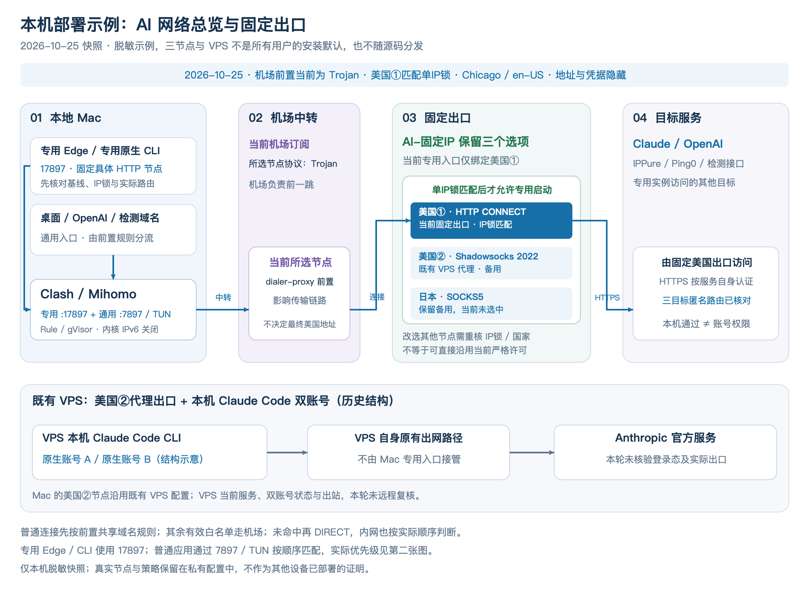
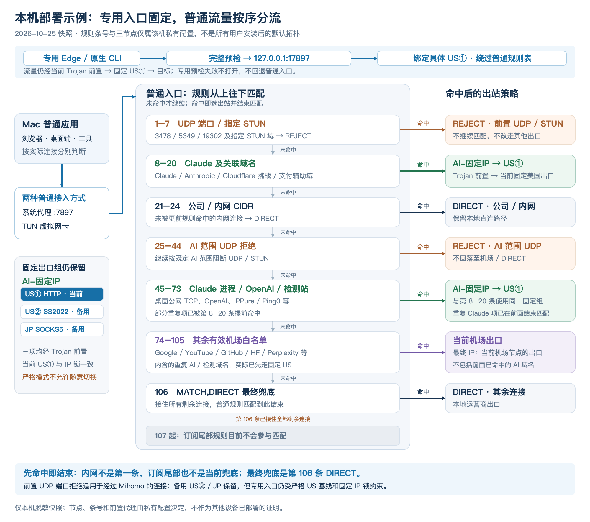

# 网络架构：本机部署示例（2026-10-25快照）

这两张图是维护者一台Mac的**脱敏部署示例**，不是所有用户安装后的默认拓扑。图中的三个固定出口、机场订阅、VPS和规则条号来自该机私有配置，不随源码分发；图片也不能证明其他电脑、手机或VPS已经部署、可用。

节点使用US①、US②、JP等示意名称，`AI-固定IP`也是图中的脱敏组名。真实地址、凭据、账号资料和完整私有配置不在本页或图文件中。

## 总览

[可编辑SVG图源](../assets/network/overview.svg)

## 三条路径

| 路径 | 入口与出口选择 | 覆盖边界 |
|---|---|---|
| 专用Edge／专用原生CLI | 先核对严格基线、固定IP与实际路由，再进入本机HTTP listener。此快照端口为17897，绑定具体US①节点，绕过普通规则表。 | 仅使用对应专用入口的进程；不是整台Mac的统一出口。CLI另有出站沙箱，Edge保留自身沙箱。 |
| 普通浏览器、Claude桌面端及其他工具 | 经普通7897入口或TUN进入同一Mihomo，按首次匹配规则选择固定出口、机场或DIRECT。 | 不是所有外网都走代理。普通浏览器访问匹配前置共享域名的目标时，也会走对应固定出口。 |
| 既有VPS | Mac若使用US②，可把该VPS代理作为最终出口；VPS本机运行的CLI使用它自身的出网路径。 | 双账号是历史使用结构示意，本轮未核验VPS登录态、隔离方式、服务状态或实际IPv4／IPv6出口。 |

本机固定出口节点通过`dialer-proxy`使用机场前置。实际传输顺序仍是 **Mac → 机场前置 → 固定出口 → 目标**；listener绑定具体出口节点，不代表物理链路省掉机场这一跳。VPS本机CLI不随Mac的节点选择切换。

三个固定选项仍保留，但此快照的单IP锁和严格US基线只接受当前US①。保留备用US②、JP，不等于可以切过去后沿用当前启动许可。

## 普通入口的真实匹配顺序

[可编辑SVG图源](../assets/network/routing.svg)

这台Mac在快照时的顺序是：

| 规则位置 | 行为 |
|---|---|
| 1–7 | 前置UDP端口及指定STUN域名拒绝；这组规则不限于专用Edge。 |
| 8–20 | Claude及关联验证、支付、辅助域名使用固定出口。 |
| 21–24 | 未被前面规则命中的公司／内网CIDR直连。 |
| 25–44 | AI范围UDP拒绝。 |
| 45–73 | Claude桌面进程、OpenAI及检测站等使用固定出口；其中部分重复项已在前面命中。 |
| 74–105 | 其余有效机场白名单，如Google、YouTube、GitHub、Hugging Face、Perplexity；重复AI／检测域名不会到这里重新选择出口。 |
| 106 | `MATCH,DIRECT`接住剩余连接。 |
| 107起 | 订阅尾部规则仍在配置中，但已被前面的MATCH截住，当前不再参与匹配。 |

这些条号不能套用到其他订阅或设备。`MATCH,DIRECT`本来就存在，本图是将实际顺序和不可达尾部展开说明，不是本次画图新增了DIRECT兜底。专用17897入口不经过这张普通规则表。

## DNS与本地防护

本机快照使用Fake-IP、`any:53` DNS劫持，以及公共端点1.1.1.1／1.0.0.1的DoH；私有DNS URL的`#`后缀指定固定出站组。这是该机选择，不是本项目对所有用户强制的DNS默认值，不能直接复制成其他网络的完整配置。

Fake-IP返回、DoH配置或匿名目标探测通过，都不能单独证明所有应用、所有DNS／DoH／DoT路径和WebRTC路径已被完整核验。专用Edge关闭自身DoH、QUIC和非代理UDP；普通浏览器的已有设置另行管理。

专用入口使用Chicago／en_US／en-US作为本地严格基线，保留真实UA和系统字体。指定页面的字体测量过滤不等于删除或全面隐藏系统字体；Local Fonts权限拒绝也不等于阻止全部Canvas／DOM／Worker探测。定位、摄像头、麦克风等默认拒绝可能影响相应功能，完整边界见[字体组件说明](PLUGIN-FONT-GUARD.md)和[使用说明](USAGE-SAFETY.md)。

桌面保镖只做有限范围的Claude桌面主进程监测；连续故障或缺证可触发停止，存在巡检窗口，不是系统防火墙，也不负责停止浏览器或独立CLI。匿名网络响应、本地检查通过与账号模型权限、地区资格是不同层次。

## 对应实现

- [专用浏览器启动参数与权限基线](../core/protected-access.py#L45)、[启动前严格预检](../core/protected-access.py#L248)、[CLI代理与Seatbelt](../core/protected-access.py#L276)。
- [匿名TLS／HTTP探测与控制器连接核对](../core/network-audit.py#L65)、[固定出口及listener核验](../core/network-audit.py#L178)。
- [订阅末尾规则与listener模板](../core/clash-profile-guard.js)、[受管脚本持久化与未知变更保护](../core/clash-profile-guard.py#L93)。实际生效仍需核对重生成后的配置及运行控制器。
- [桌面保镖](../daemons/claude-bodyguard.sh)、[时区看门狗](../daemons/tz-watchdog.sh)、[字体组件匹配范围](../core/font-guard/manifest.json)。

SVG是可编辑矢量源，PNG由对应的最终SVG导出；图文件自包含，不加载外部资源。本次图文维护没有改动网络配置，也没有重新验证历史VPS账号。
