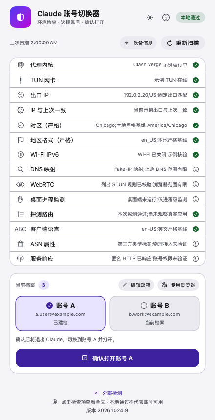
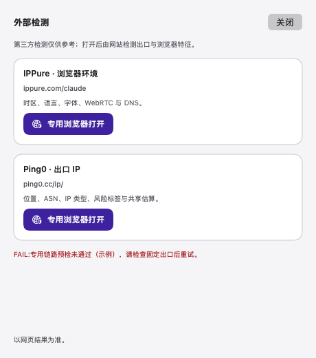

# 外部检测与单一应用入口交付记录

构建版本：**20261024.9**。继承[20261024.8字体过滤与版本显示](RELEASE-2026-10-24-FONT-GUARD.md)，新增用户已确认的“按钮＋弹窗”外部检测入口，并落实成功升级后只保留最新App的原则。

## 功能

- 主窗口下方增加“外部检测”，保持440×860及黑白主题；实际Bundle版本继续放在最底部。
- 弹窗概括IPPure浏览器环境与Ping0出口IP的检查用途；只允许两个固定ID映射到用户给定HTTPS地址。
- 每次通过完整专用预检打开；预检期间互斥，错误在弹窗可读，非零退出不能伪报成功。无参数专用浏览器入口保持兼容。
- 不抓取网页分数、不自动填IP、不将第三方评分混入14项，不恢复账号状态备注。字体组件范围没有因Ping0入口扩大。
- 正式App路径固定在用户Applications，桌面与程序坞统一指向此处。已发现的程序坞旧入口此前指向20261024.3备份包，本轮精准改到正式路径，原位置与其他固定项保持不变。
- 安装替换期间保留恢复能力，最终核验成功后清理本次替换的旧App；失败及未知并发目标保留。不扫描全盘历史目录，不将账号、浏览器或普通软件当作旧版删除。

说明与来源见[外部检测使用说明](EXTERNAL-CHECKS.md)，调用及验收设计见[设计文档](plans/2026-10-24-external-checks-design.md)。

## 验证

- Python隔离测试183项全部通过，覆盖固定目标、非法输入、完整预检、分派、字体完整性、安装成功清理及失败恢复；其中安装布局11项。
- Swift模型21个隔离场景通过，包括默认入口、两个检测目标、重入阻断、非零退出和空结果；没有操作本机真实A/B。
- 两个固定检测网址经专用代理的无认证HTTP请求均返回200；这不代表已自动取得网页检测分数。
- 双架构编译及黑白主窗口／弹窗离屏渲染检查。预览采用独立假数据和测试地址，不读取真实核心、账号或偏好。
- 本机安装、签名与源文件哈希回读，以及打包校验另记录在交付工件；网页加载和第三方实际结果与本地预检分别表述。

历史用户验收：.8底部版本正确，专用Edge的IPPure字体0分、总分2分；这不是.9新增自动扫描，也不是持续结果。

## 隔离布局预览

[黑色主窗口](../assets/previews/external-checks-main-black.png) · [黑色弹窗](../assets/previews/external-checks-black.png)
