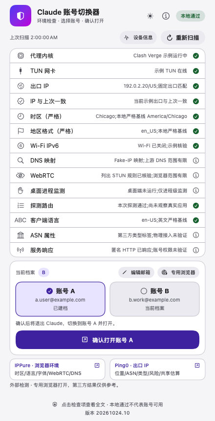

# 主界面平铺外部检测

版本：**20261024.10**。用户反馈二级页面操作繁琐，本轮将IPPure与Ping0的用途说明、打开入口直接放到主界面，移除外部检测弹窗及其状态代码。

点击对应入口即可进入原有专用预检，再用专用Edge打开固定网站。预检进度和结果直接显示在主窗口，固定ID、代理、权限和字体组件均沿用上一版；没有增加自动抓分。版本号继续显示在最下面。

本轮验证范围为Swift模型原有21个隔离交互场景、安装布局11项、双架构编译及黑白布局渲染。上一版183项全量Python回归是20261024.9的历史记录，本次不将其改写成重新执行的结果。

安装核验成功后清理本次被替换的20261024.9 App；实际路径仍固定在用户Applications，桌面和程序坞指向该位置。

[黑色主界面](../assets/previews/inline-checks-black.png)
