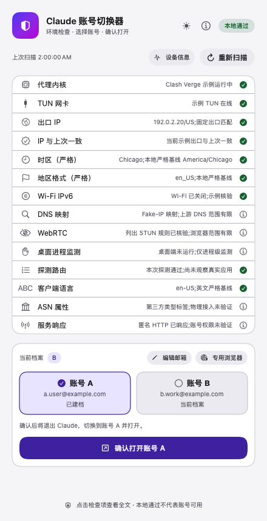

# 本机严格专用链路交付记录

交付版本：**20261024.7**。本轮在已安装6的严格专用链路基础上，按用户要求移除账号状态备注及核心历史观察读取，并汇总全部注意事项。真实账号、浏览器登录资料、代理凭据和本机配置不进入公开仓库。

## 交付内容

- [注意事项与落实总清单](CLAUDE-SAFETY-CHECKLIST.md)：区分已落实、未实施及原因、用户自行处理。新号等约一周再订阅、邮箱品牌、礼品卡和95%额度等经验不包装成官方门槛。
- [微信9篇及辅助材料](RESEARCH-2026-10-24-WECHAT.md)、[新增Google/GitHub交叉总结](RESEARCH-2026-10-24-SOURCE-COMPARISON.md)、[两张用户截图核对](RESEARCH-2026-10-24-USER-SCREENSHOTS.md)，保留来源、版本及访问范围。
- 专用Mihomo HTTP入口直接固定具体US节点；普通代理、普通浏览器、公司内网及默认供应商用途保留。
- 专用Edge限制权限、预加载、扩展与默认第三方Cookie；固定有效英文语言与Chicago信号。落盘UI备用语言不等于当前网页语言，仍严格检查有效语言与启动参数。
- 原生CLI的TCP专用端口约束、子进程及两条broker限制，清理意外凭据库覆盖；[启动器与设置脱敏模板](CLI-NATIVE-LAUNCHER.md)记录本机特定配置的改动逻辑。
- 桌面守护对连续故障或缺证采取停止；账号档案失败保留恢复现场，`current.new`事务与类型检查防止错误归档。
- 实际App放在用户Applications，桌面同名入口为链接，避开桌面同步元数据对签名的影响；安装／卸载保留未知目标并保存可恢复旧包。
- 账号状态备注不再展示、扫描不再读取，核心观察函数已删除。旧命令只返回移除提示，原`status`协议和邮箱标签保留。

## 本轮验证

| 验证 | 已确认结果 |
|---|---|
| Python回归 | 160项通过，覆盖路由、隐私、CLI分派、守护、归档和安装布局等；使用隔离HOME及fake API。 |
| Swift账号交互 | 14个隔离场景通过，包含全流程不调用账号备注。未切换真实A/B。 |
| 网络维护恢复 | 18项fixture/fake API测试通过；真实重生成前启动独立恢复任务，通过后接受并确认watch退休。 |
| 专用listener | 实际生成配置唯一、仅127.0.0.1监听；Cloudflare/Claude/API入站名、端口、强制proxy及节点链通过，固定IP/US核对通过。未列入普通Claude规则的公开测试域也命中固定proxy。 |
| 故障对照 | 独立Mihomo上游停用、真实Edge临时代理停止／拒绝CONNECT均失败，普通对照仍可用；没有停用真实Clash测试。 |
| 浏览器实际信号 | HTTP与JavaScript为en-US/en、Intl为en-US/Chicago、DST偏移匹配；八类查询权限denied、定位请求拒绝。正常退出后无再次硬化仍可重启并重复通过。未注入假navigator属性。 |
| CLI实测 | 指定代理TCP可通；其他测试端口、UDP及子进程直连拒绝；内核检查lsopen/appleevent-send均拒绝；意外凭据库覆盖已移除，调用方配置目录保留；官方CLI离线版本2.1.310正常。 |
| 本机应用与系统模块 | 实际包及桌面链接完整strict验签；root模块哈希、root所有权／755及用户不可写回读。14项核心检查无未解决故障；用户确认移除备注前窗口本地通过、无红黄。 |
| 去备注布局 | 黑白离屏渲染通过，确认按钮和页脚完整。示例数据预览不作为真实网络或账号证明。 |

## 仍有范围限制

未验证账号模型权限、服务端资格和受限原因；未全面验证全部DNS/WebRTC/WSS、已认证CLI与全部MCP／工具、休眠及切网。`edge://policy`有效策略页和新版真实窗口自动抓取受系统屏幕捕获组件故障影响，已知plist检查不能代替所有有效策略；去备注布局采用隔离渲染和模型回归。桌面守护仍有巡检窗口，不是全机防火墙。

摄像头／音视频拒绝、CLI自动开浏览器受限和子进程直连拒绝可能影响正常功能，具体处理见总清单。公共源码和备份包不等于其他Mac或手机已完成部署。

## 去备注界面预览

以下仅是生产视图配合**隔离示例数据**的布局预览；IP为保留测试地址，邮箱使用example.com。

[黑色预览](../assets/previews/strict-no-note-black.png)
