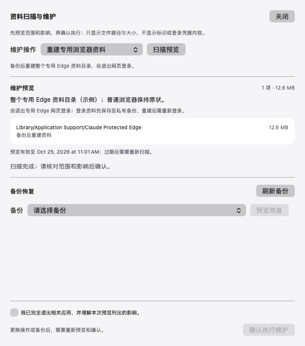
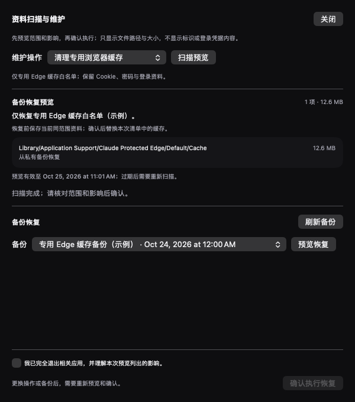

# 资料扫描与可恢复维护（20261025.2）

本版参考CCBaga的分级清理与预览方式，将资料扫描、明确确认、私有备份及恢复接入现有SwiftUI/Python切换器。扫描不再只给出字体/GPU线索：用户可以查看指定资料范围内实际发现的文件、大小与处理影响，再决定是否执行。

## 交付内容

- 主窗口增加“资料维护”，外部检测继续平铺，版本号仍在最下面。
- 四个固定范围：专用Edge缓存、专用Edge资料重建、当前Claude桌面本地ID、预置独立原生CLI目录的本地ID。
- 一次性预览令牌有有效期，文件新增/修改、客户端重新运行或目标变化时停止并要求重新扫描。
- 保存私有备份后执行同卷事务；恢复前保留当前资料。原生CLI配置仅改/恢复三个ID字段，其他配置逐值保留。
- 桌面备份绑定本地A/B档案槽位；预览或恢复时槽位不同会拒绝，不把A档案的标识写进B。
- 浏览器、原生CLI和桌面切号参与对应维护锁。原生CLI启动使用共享锁，允许多个正常会话；维护需要排他锁。
- 初始日志原子发布，移动使用原子不覆盖语义；中断回滚始终保持待恢复状态，未完成时阻止相应入口。
- 备份签名绑定记录版本和有序目标清单，未来范围变更不会悄悄把旧备份恢复到错误位置。

没有接入Fingerprint Chromium、随机种子轮换、钥匙串身份保险库或VPS部署。硬件特征与服务端记录不是本地ID维护的处理对象，清理也不验证账号权限。

## 验证

后端53项专项隔离测试覆盖固定范围、数据保留、失效/重放、链接/所有者、原子不覆盖、并发锁、每步故障、中断恢复及JSON窄恢复。Swift模型51个隔离交互场景通过，覆盖预览不执行、确认门槛、模式变化失效、互斥、异常协议和恢复确认。最终Python全量回归244项通过，已包含上述后端53项；Swift交互51项另行执行，不将专项重复计数。

黑白主窗口和维护预览／错误／恢复页用生产视图配合隔离示例数据验证；图里的时间、大小和文件存在性均为示例，不代表已扫描或清理用户真实资料。App使用双架构构建和独立签名核验。

真实账号、Cookie、钥匙串、A/B存档及原生CLI资料没有用于清理验收。普通启动成功、隔离测试和真实清理是不同验证阶段；用户需要在维护页核对实际预览并主动确认。

## 界面示例

[黑色维护预览](../assets/previews/maintenance-preview-black.png) · [白色恢复预览](../assets/previews/maintenance-restore-white.png)

完整范围、命令和限制见[资料维护说明](LOCAL-MAINTENANCE.md)，实现决策见[设计记录](plans/2026-10-25-local-maintenance.md)。
